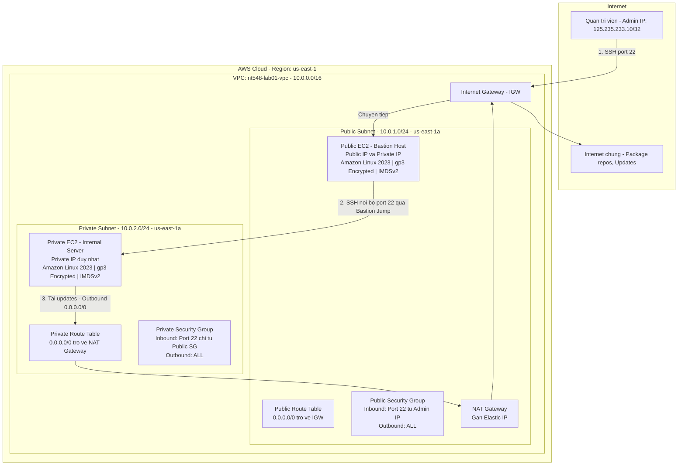

# BÁO CÁO PHÂN TÍCH VÀ GIẢI THÍCH MÃ NGUỒN TOÀN DIỆN
## DỰ ÁN: NT548 LAB 01 - AWS INFRASTRUCTURE AS CODE (TERRAFORM & CLOUDFORMATION)

---

## MỤC LỤC
1. [CẤP ĐỘ 1: TỔNG QUAN HỆ THỐNG (GENERAL LEVEL)](#1-cấp-độ-1-tổng-quan-hệ-thống-general-level)
   - 1.1. Mục tiêu và bài toán giải quyết
   - 1.2. Kiến trúc giải pháp (Architecture Overview)
   - 1.3. Mô hình luồng mạng và bảo mật
   - 1.4. So sánh phương pháp triển khai: Terraform vs CloudFormation
2. [CẤP ĐỘ 2: CÁC MODULE CHỨC NĂNG (MODULE LEVEL)](#2-cấp-độ-2-các-module-chức-năng-module-level)
   - 2.1. Module Mạng (Network Module)
   - 2.2. Module Cổng chuyển dịch địa chỉ mạng (NAT Module)
   - 2.3. Module Điều hướng (Routing Module)
   - 2.4. Module An ninh và Tường lửa (Security Module)
   - 2.5. Module Điện toán máy chủ (Compute Module)
   - 2.6. Thành phần Đặc biệt: CloudFormation Custom Resource (Lambda SG Lockdown)
3. [CẤP ĐỘ 3: PHÂN TÍCH TỪNG TẬP TIN (FILE LEVEL)](#3-cấp-độ-3-phân-tích-từng-tập-tin-file-level)
   - 3.1. Cấu trúc cây thư mục dự án
   - 3.2. Nhóm tập tin cấu hình gốc Terraform
   - 3.3. Nhóm tập tin Module Network
   - 3.4. Nhóm tập tin Module Security
   - 3.5. Nhóm tập tin Module NAT
   - 3.6. Nhóm tập tin Module Routing
   - 3.7. Nhóm tập tin Module Compute
   - 3.8. Nhóm tập tin CloudFormation
4. [CẤP ĐỘ 4: GIẢI THÍCH TỪNG ĐOẠN MÃ CHI TIẾT (CODE BLOCK DEEP DIVE)](#4-cấp-độ-4-giải-thích-từng-đoạn-mã-chi-tiết-code-block-deep-dive)
   - 4.1. Khởi tạo Provider và Profile AWS
   - 4.2. Xây dựng VPC và Subnets
   - 4.3. Cô lập Default Security Group (Hardening Technique)
   - 4.4. Security Group Chaining (Tham chiếu bảo mật chéo)
   - 4.5. Định tuyến Internet với Internet Gateway và NAT Gateway
   - 4.6. Truy vấn AMI tự động (Data Source & SSM Parameter)
   - 4.7. Cấu hình bảo mật EC2: IMDSv2 và EBS Encryption gp3
   - 4.8. Cơ chế Lambda Custom Resource trong CloudFormation
   - 4.9. Kỹ thuật SSH Bastion Host (Jump Host) qua ProxyCommand
5. [TỔNG KẾT VÀ BÀI HỌC THỰC TIỄN (BEST PRACTICES)](#5-tổng-kết-và-bài-học-thực-tiễn-best-practices)

---

## 1. CẤP ĐỘ 1: TỔNG QUAN HỆ THỐNG (GENERAL LEVEL)

### 1.1. Mục tiêu và bài toán giải quyết
Dự án **NT548 Lab 01** thuộc môn học về Điện toán Đám mây / DevOps / Quản trị mạng. Mục tiêu cốt lõi của bài lab là:
- **Tự động hóa hoàn toàn hạ tầng đám mây (Infrastructure as Code - IaC)** trên nền tảng Amazon Web Services (AWS).
- Thay vì cấu hình thủ công bằng tay trên AWS Management Console (dễ nhầm lẫn, khó tái lập), toàn bộ hạ tầng được mô tả bằng code để có thể triển khai, kiểm thử, quản lý phiên bản và hủy bỏ một cách nhất quán.
- Thiết kế một môi trường mạng phân tầng bảo mật kinh điển: **Kiến trúc 2 lớp (2-Tier VPC Architecture)** gồm một phân vùng công khai (Public Subnet) và một phân vùng nội bộ biệt lập (Private Subnet).

### 1.2. Kiến trúc giải pháp (Architecture Overview)
Hạ tầng bao gồm các thành phần sau nằm trong một VPC (Virtual Private Cloud):
- **VPC** dải mạng `10.0.0.0/16`: Đóng vai trò là một trung tâm dữ liệu ảo độc lập trên AWS.
- **1 Availability Zone (us-east-1a)**: Toàn bộ subnet được đặt chung trong 1 AZ để tối ưu chi phí và độ trễ.
- **Public Subnet (`10.0.1.0/24`)**:
  - Chứa một máy chủ **Public EC2 (Bastion Host / Jump Box)** có gắn Public IP.
  - Chứa một **NAT Gateway** có gắn Elastic IP (EIP).
  - Kết nối trực tiếp ra Internet thông qua **Internet Gateway (IGW)**.
- **Private Subnet (`10.0.2.0/24`)**:
  - Chứa một máy chủ **Private EC2 (Backend / Database Server)** chỉ có IP nội bộ (`10.0.2.x`), tuyệt đối không có Public IP.
  - Được bảo vệ nghiêm ngặt: Internet từ ngoài không thể chủ động kết nối vào được.
  - Khi cần tải thư viện, cập nhật phần mềm (`yum update`), máy chủ này gửi gói tin qua **NAT Gateway** ở Public Subnet để đi ra ngoài một chiều.



### 1.3. Mô hình luồng mạng và bảo mật
1. **Luồng truy cập quản trị (Inbound Management Flow)**:
   - Admin chỉ có thể SSH vào `Public EC2` từ đúng IP đã được cấp phép (`125.235.233.10/32`). Mọi IP khác trên Internet đều bị Firewall (Security Group) chặn đứng.
   - Để truy cập vào `Private EC2`, Admin phải dùng `Public EC2` làm bàn đạp (Bastion/Jump Host). `Private Security Group` cấu hình chỉ chấp nhận traffic port 22 đến từ các máy chủ thuộc `Public Security Group`. Kẻ tấn công dù biết IP private cũng không thể kết nối từ bên ngoài.
2. **Luồng kết nối ra ngoài (Outbound Internet Flow)**:
   - `Public EC2`: Gửi traffic qua Public Route Table (`0.0.0.0/0 -> Internet Gateway`).
   - `Private EC2`: Gửi traffic qua Private Route Table (`0.0.0.0/0 -> NAT Gateway`). NAT Gateway tiến hành dịch địa chỉ IP nguồn (Source NAT) thành Elastic IP của nó và gửi qua Internet Gateway ra ngoài. Phản hồi từ Internet quay lại NAT Gateway và được trả về đúng `Private EC2`. Nhờ vậy, `Private EC2` ra được Internet nhưng Internet không thể khởi tạo kết nối vào nó.
3. **Tiêu chuẩn an toàn điện toán (Compute Hardening Standards)**:
   - **Default Security Group Lockdown**: Khóa hoàn toàn Default SG của VPC (xóa hết Ingress và Egress) theo chuẩn CIS AWS Foundations Benchmark, tránh rò rỉ bảo mật nếu ai đó tạo resource mà quên chỉ định SG.
   - **Mã hóa lưu trữ (EBS Encryption)**: Cả 2 máy chủ dùng ổ đĩa thế hệ mới `gp3`, dung lượng 8 GiB và bật mã hóa toàn phần (`encrypted = true`).
   - **Bảo vệ Metadata (IMDSv2)**: Yêu cầu bắt buộc dùng `http_tokens = "required"`, chống kỹ thuật tấn công SSRF (Server-Side Request Forgery) đánh cắp IAM Role credentials.

### 1.4. So sánh phương pháp triển khai: Terraform vs CloudFormation

Dự án cung cấp 2 mã nguồn độc lập song song để giải quyết cùng 1 đề bài:

| Tiêu chí so sánh | Triển khai bằng Terraform | Triển khai bằng CloudFormation |
| :--- | :--- | :--- |
| **Định dạng file** | HCL (HashiCorp Configuration Language) - `*.tf` | YAML / JSON - `template.yaml` |
| **Kiến trúc mã nguồn** | **Modularized**: Chia thành 5 module con (`network`, `nat`, `routing`, `security`, `compute`). | **Monolithic**: Gom toàn bộ resource vào 1 file mẫu duy nhất. |
| **Quản lý State** | File `terraform.tfstate` lưu tại máy local (hoặc S3 backend). | Quản lý ngầm và lưu trữ tự động bởi dịch vụ AWS CloudFormation engine. |
| **Tìm kiếm AMI** | Sử dụng Data Source `aws_ami` với bộ lọc linh hoạt. | Sử dụng Dynamic Parameter từ AWS SSM Parameter Store (`AWS::SSM::Parameter::Value<AWS::EC2::Image::Id>`). |
| **Khóa Default Security Group** | Tích hợp sẵn resource chính chủ `aws_default_security_group`. | AWS CloudFormation **không có** resource tương đương; phải viết 1 hàm AWS Lambda (Custom Resource bằng Python) để xóa rules. |
| **Tính đa nền tảng** | Công cụ độc lập, tương thích đa đám mây (Multi-cloud). | Công cụ Native độc quyền của AWS. |

---

## 2. CẤP ĐỘ 2: CÁC MODULE CHỨC NĂNG (MODULE LEVEL)

Trong thư mục `terraform/modules/`, mã nguồn được module hóa cao độ theo từng trách nhiệm duy nhất (Single Responsibility Principle):

```
terraform/modules/
├── network/    --> Khung xương mạng nền tảng (VPC, Subnets, IGW)
├── nat/        --> Cổng dịch địa chỉ mạng (EIP, NAT Gateway)
├── routing/    --> Bảng định tuyến và liên kết bảng định tuyến (Route Tables)
├── security/   --> Tường lửa cấp máy chủ (Security Groups & Rules)
└── compute/    --> Máy chủ ảo hóa (EC2 Instances & Launch Specs)
```

### 2.1. Module Mạng (`modules/network`)
- **Nhiệm vụ chính**: Xây dựng nền móng hạ tầng mạng ban đầu.
- **Các thành phần sở hữu**:
  1. `aws_vpc`: Khởi tạo dải mạng riêng ảo `10.0.0.0/16`.
  2. `aws_subnet.public`: Phân mạng công khai `10.0.1.0/24`, bật tính năng tự cấp Public IP (`map_public_ip_on_launch = true`).
  3. `aws_subnet.private`: Phân mạng nội bộ `10.0.2.0/24`, tắt tính năng cấp Public IP (`map_public_ip_on_launch = false`).
  4. `aws_internet_gateway`: Cửa ngõ kết nối VPC với mạng Internet bên ngoài.
- **Input**: `vpc_cidr`, `project_name`, `availability_zone`, `public_subnet_cidr`, `private_subnet_cidr`.
- **Output**: `vpc_id`, `public_subnet_id`, `private_subnet_id`, `internet_gateway_id`.

### 2.2. Module NAT (`modules/nat`)
- **Nhiệm vụ chính**: Cung cấp khả năng truy cập Internet chiều ra (outbound) cho các tài nguyên trong mạng Private.
- **Các thành phần sở hữu**:
  1. `aws_eip`: 1 địa chỉ IP tĩnh công cộng (Elastic IP) dành riêng cho NAT Gateway.
  2. `aws_nat_gateway`: Thiết bị NAT gateway nằm ở **Public Subnet** và gắn với Elastic IP trên.
- **Input**: `public_subnet_id`, `project_name`.
- **Output**: `nat_gateway_id`, `nat_public_ip`.

### 2.3. Module Điều hướng (`modules/routing`)
- **Nhiệm vụ chính**: Xác định bản đồ chỉ đường cho các gói tin mạng từ từng Subnet.
- **Các thành phần sở hữu**:
  1. `aws_route_table.public` & `aws_route`: Bảng định tuyến Public với đường đi `0.0.0.0/0` trỏ tới Internet Gateway (`var.internet_gateway_id`).
  2. `aws_route_table_association.public`: Gắn bảng định tuyến Public vào Public Subnet.
  3. `aws_route_table.private` & `aws_route`: Bảng định tuyến Private với đường đi `0.0.0.0/0` trỏ tới NAT Gateway (`var.nat_gateway_id`).
  4. `aws_route_table_association.private`: Gắn bảng định tuyến Private vào Private Subnet.
- **Input**: `vpc_id`, `public_subnet_id`, `internet_gateway_id`, `private_subnet_id`, `nat_gateway_id`, `project_name`.
- **Output**: `public_route_table_id`, `private_route_table_id`.

### 2.4. Module An ninh và Tường lửa (`modules/security`)
- **Nhiệm vụ chính**: Kiểm soát luồng dữ liệu vào/ra (Stateful Firewall) ở cấp độ mạng ảo hóa.
- **Các thành phần sở hữu**:
  1. `aws_default_security_group`: Tiếp quản Default SG của VPC và xóa toàn bộ rules (Zero-trust).
  2. `aws_security_group.public`: Nhóm an ninh cho máy chủ Bastion.
  3. `aws_security_group.private`: Nhóm an ninh cho máy chủ Private.
  4. `aws_vpc_security_group_ingress_rule.public_ssh`: Chỉ mở port 22 cho IP của Admin (`allowed_ssh_cidr`).
  5. `aws_vpc_security_group_ingress_rule.private_ssh`: Chỉ mở port 22 khi nguồn gốc kết nối xuất phát từ các máy chủ thuộc nhóm `aws_security_group.public`.
  6. Egress rules: Cho phép toàn bộ traffic ra ngoài (`0.0.0.0/0`, all protocols).
- **Input**: `vpc_id`, `project_name`, `allowed_ssh_cidr`.
- **Output**: `public_security_group_id`, `private_security_group_id`.

### 2.5. Module Điện toán máy chủ (`modules/compute`)
- **Nhiệm vụ chính**: Khởi tạo và bảo mật các máy chủ ảo hóa EC2.
- **Các thành phần sở hữu**:
  1. `data "aws_ami" "amazon_linux"`: Bộ truy vấn tự động lấy ID bản phân phối Amazon Linux 2023 mới nhất từ AWS.
  2. `aws_instance.public`: Máy chủ Bastion Host, đặt tại Public Subnet, có Public IP.
  3. `aws_instance.private`: Máy chủ nội bộ, đặt tại Private Subnet, không có Public IP.
  4. Tiêu chuẩn áp dụng trên cả 2 máy chủ: Ổ đĩa root EBS gp3 8 GiB mã hóa, bắt buộc IMDSv2.
- **Input**: `project_name`, `instance_type`, `key_name`, các Subnet IDs và Security Group IDs.
- **Output**: `public_instance_id`, `private_instance_id`, `public_ip`, `private_ip`, `ami_id`.

### 2.6. Thành phần Đặc biệt: CloudFormation Custom Resource (Lambda SG Lockdown)
Trong CloudFormation không có resource để can thiệp vào Default Security Group sinh ra tự động bởi VPC. Template đã giải quyết bằng:
- **IAM Role** (`DefaultSecurityGroupRole`): Cấp quyền cho Lambda thực hiện `ec2:DescribeSecurityGroups`, `ec2:RevokeSecurityGroupIngress`, `ec2:RevokeSecurityGroupEgress`, `ec2:CreateTags`.
- **Lambda Function** (`DefaultSecurityGroupFunction`): Viết bằng Python 3.12, tự động tìm default SG của VPC và gọi API AWS Boto3 để thu hồi (revoke) toàn bộ quyền Ingress và Egress.
- **Custom Resource** (`RestrictDefaultSecurityGroup`): Kích hoạt hàm Lambda khi Stack đang được tạo.

---

## 3. CẤP ĐỘ 3: PHÂN TÍCH TỪNG TẬP TIN (FILE LEVEL)

### 3.1. Cấu trúc cây thư mục dự án
```
Lab1_Devops/
├── README.md                      # Hướng dẫn tổng quan bài Lab
├── .gitignore                     # Bỏ qua các file nhạy cảm, cache, venv
├── cloudformation/
│   ├── README.md                  # Hướng dẫn vận hành CloudFormation CLI
│   └── template.yaml              # Toàn bộ hạ tầng dưới dạng 1 file CFN Template
└── terraform/
    ├── providers.tf               # Khai báo AWS Provider và profile learner-lab
    ├── main.tf                    # File gốc kết nối 5 modules lại với nhau
    ├── outputs.tf                 # Xuất thông tin IP, VPC ID sau khi tạo
    └── modules/
        ├── compute/               # [Module] Máy chủ EC2
        │   ├── main.tf
        │   ├── outputs.tf
        │   └── variables.tf
        ├── nat/                   # [Module] NAT Gateway & Elastic IP
        │   ├── main.tf
        │   ├── outputs.tf
        │   └── variables.tf
        ├── network/               # [Module] VPC, Subnets, IGW
        │   ├── main.tf
        │   ├── outputs.tf
        │   └── variable.tf
        ├── routing/               # [Module] Route Tables & Associations
        │   ├── main.tf
        │   ├── outputs.tf
        │   └── variable.tf
        └── security/              # [Module] Security Groups & Rules
            ├── main.tf
            ├── outputs.tf
            └── variables.tf
```

---

### 3.2. Nhóm tập tin cấu hình gốc Terraform

#### 📄 `terraform/providers.tf`
- **Mục đích**: Thiết lập phiên bản phần mềm AWS Provider cho Terraform và định cấu hình quyền xác thực (credentials).
- **Chi tiết**:
  - `required_providers`: Khóa version AWS Provider ở mức `~> 6.0` (tương thích phiên bản từ 6.0 đến dưới 7.0).
  - Khối `provider "aws"`: Thiết lập vùng triển khai `us-east-1` và chỉ định profile CLI là `learner-lab` (phù hợp với môi trường thực hành AWS Academy / Learner Lab).

#### 📄 `terraform/main.tf`
- **Mục đích**: Là "nhạc trưởng" điều phối toàn bộ dự án, gọi và truyền tham số giữa 5 module.
- **Chi tiết liên kết**:
  - Gọi `module "network"` để lấy ra `vpc_id`, `public_subnet_id`, `private_subnet_id`, `internet_gateway_id`.
  - Gọi `module "nat"` truyền vào `public_subnet_id` và khai báo phụ thuộc tường minh `depends_on = [module.network]`.
  - Gọi `module "routing"` để nối `internet_gateway_id` vào Public Subnet và `nat_gateway_id` vào Private Subnet.
  - Gọi `module "security"` truyền vào `vpc_id` và địa chỉ IP được phép SSH `125.235.233.10/32`.
  - Gọi `module "compute"` để sinh 2 máy ảo EC2, đồng thời thiết lập `depends_on = [module.routing, module.security]` nhằm đảm bảo mạng và firewall đã sẵn sàng trước khi máy chủ được khởi chạy.

#### 📄 `terraform/outputs.tf`
- **Mục đích**: Xuất ra màn hình terminal các giá trị quan trọng sau khi lệnh `terraform apply` hoàn tất.
- **Giá trị xuất**: `vpc_id`, `public_subnet_id`, `private_subnet_id`, `public_ec2_id`, `private_ec2_id`, `public_ec2_ip`, `private_ec2_ip`, `ec2_ami_id`.

---

### 3.3. Nhóm tập tin Module Network

#### 📄 `terraform/modules/network/variable.tf`
- Khai báo các biến đầu vào của module mạng:
  - `vpc_cidr`: Dải IP của VPC (chuỗi).
  - `project_name`: Tên tiền tố gán nhãn tài nguyên (chuỗi).
  - `availability_zone`: Vùng khả dụng (ví dụ: `us-east-1a`).
  - `public_subnet_cidr`, `private_subnet_cidr`: Dải IP cho 2 subnet.

#### 📄 `terraform/modules/network/main.tf`
- Tạo 4 tài nguyên AWS:
  1. `aws_vpc.this`: VPC chính với cờ `enable_dns_support = true` và `enable_dns_hostnames = true` (cần thiết để các máy EC2 có DNS hostname nội bộ).
  2. `aws_subnet.public`: Subnet công khai, kích hoạt `map_public_ip_on_launch = true`.
  3. `aws_subnet.private`: Subnet riêng tư, tắt `map_public_ip_on_launch = false`.
  4. `aws_internet_gateway.this`: Đính kèm vào VPC thông qua `vpc_id = aws_vpc.this.id`.

#### 📄 `terraform/modules/network/outputs.tf`
- Trích xuất các ID cần thiết (`vpc_id`, `public_subnet_id`, `private_subnet_id`, `internet_gateway_id`) để truyền cho các module khác.

---

### 3.4. Nhóm tập tin Module Security

#### 📄 `terraform/modules/security/variables.tf`
- Tiếp nhận: `vpc_id`, `project_name`, và `allowed_ssh_cidr`.

#### 📄 `terraform/modules/security/main.tf`
- Định nghĩa bảo mật với cách tiếp cận hiện đại của AWS Provider (tách riêng Security Group và Rule):
  - `aws_default_security_group.this`: Rút hết toàn bộ rules của default security group.
  - `aws_security_group.public` và `aws_security_group.private`: Tạo 2 SG rỗng.
  - `aws_vpc_security_group_ingress_rule.public_ssh`: Mở port 22 tới `var.allowed_ssh_cidr`.
  - `aws_vpc_security_group_ingress_rule.private_ssh`: Mở port 22 tới `referenced_security_group_id = aws_security_group.public.id`.
  - Hai `aws_vpc_security_group_egress_rule`: Cho phép đi ra ngoài tự do (`0.0.0.0/0`, protocol `-1`).

#### 📄 `terraform/modules/security/outputs.tf`
- Xuất: `public_security_group_id` và `private_security_group_id`.

---

### 3.5. Nhóm tập tin Module NAT

#### 📄 `terraform/modules/nat/variables.tf`
- Tiếp nhận: `public_subnet_id` và `project_name`.

#### 📄 `terraform/modules/nat/main.tf`
- `aws_eip.nat`: Cấp phát 1 Elastic IP cố định (`domain = "vpc"`).
- `aws_nat_gateway.this`: Tạo NAT Gateway đặt bên trong `public_subnet_id` và gán vào `allocation_id = aws_eip.nat.id`. Chế độ `connectivity_type = "public"`.

#### 📄 `terraform/modules/nat/outputs.tf`
- Xuất: `nat_gateway_id` và địa chỉ IP tĩnh `nat_public_ip`.

---

### 3.6. Nhóm tập tin Module Routing

#### 📄 `terraform/modules/routing/variable.tf`
- Tiếp nhận 6 biến: `vpc_id`, `public_subnet_id`, `internet_gateway_id`, `private_subnet_id`, `nat_gateway_id`, `project_name`.

#### 📄 `terraform/modules/routing/main.tf`
- Tạo 2 bảng định tuyến riêng biệt:
  - Bảng Public (`aws_route_table.public`): Gắn route `0.0.0.0/0` trỏ tới Internet Gateway, sau đó kết nối vào Public Subnet (`aws_route_table_association.public`).
  - Bảng Private (`aws_route_table.private`): Gắn route `0.0.0.0/0` trỏ tới NAT Gateway, sau đó kết nối vào Private Subnet (`aws_route_table_association.private`).

#### 📄 `terraform/modules/routing/outputs.tf`
- Xuất: `public_route_table_id` và `private_route_table_id`.

---

### 3.7. Nhóm tập tin Module Compute

#### 📄 `terraform/modules/compute/variables.tf`
- Tiếp nhận: `project_name`, `instance_type`, `key_name`, cùng các Subnet IDs và Security Group IDs tương ứng.

#### 📄 `terraform/modules/compute/main.tf`
- `data "aws_ami" "amazon_linux"`: Lọc tìm image `al2023-ami-2023.*-kernel-*-x86_64` thuộc sở hữu của Amazon (`owners = ["amazon"]`).
- `aws_instance.public`:
  - Đặt trong `var.public_subnet_id`.
  - Gán `var.public_security_group_id`.
  - Bật `associate_public_ip_address = true`.
  - Cấu hình đĩa cứng: `gp3`, `8 GiB`, `encrypted = true`.
  - Cấu hình an toàn: `http_tokens = "required"` (IMDSv2).
- `aws_instance.private`:
  - Đặt trong `var.private_subnet_id`.
  - Gán `var.private_security_group_id`.
  - Tắt `associate_public_ip_address = false`.
  - Cùng cấu hình đĩa cứng gp3 và IMDSv2 như máy Public.

#### 📄 `terraform/modules/compute/outputs.tf`
- Xuất: `public_instance_id`, `private_instance_id`, `public_ip`, `private_ip`, `ami_id`.

---

### 3.8. Nhóm tập tin CloudFormation

#### 📄 `cloudformation/README.md`
- Tài liệu hướng dẫn chi tiết cách:
  - Kiểm tra cú pháp template: `aws cloudformation validate-template`.
  - Triển khai Stack: `aws cloudformation deploy --capabilities CAPABILITY_IAM`.
  - Đọc Output của Stack và câu lệnh SSH tương ứng.
  - Xóa Stack sạch sẽ: `aws cloudformation delete-stack`.

#### 📄 `cloudformation/template.yaml`
- Tập tin khai báo toàn bộ tài nguyên tương đương với Terraform:
  - Khối `Parameters`: Khai báo các tham số đầu vào (`ProjectName`, `VpcCidr`, `AllowedSshCidr`, `KeyName`, `AmiParameter`,...).
  - Khối `Resources`: Khai báo VPC, Subnets, IGW, NAT, Route Tables, Security Groups, Launch Template, EC2 Instances.
  - Khối `Custom Resource + Lambda`: Xử lý hạn chế Default Security Group.
  - Khối `Outputs`: Xuất các thông số hạ tầng sau triển khai.

---

## 4. CẤP ĐỘ 4: GIẢI THÍCH TỪNG ĐOẠN MÃ CHI TIẾT (CODE BLOCK DEEP DIVE)

### 4.1. Khởi tạo Provider và Profile AWS
Trong `terraform/providers.tf`:
```hcl
terraform {
  required_providers {
    aws = {
      source  = "hashicorp/aws"
      version = "~> 6.0"
    }
  }
}

provider "aws" {
  region  = "us-east-1"
  profile = "learner-lab"
}
```
**Giải thích cặn kẽ**:
- `version = "~> 6.0"`: Toán tử `~>` (pessimistic constraint) cho phép nâng cấp các bản vá lỗi (ví dụ: `6.1`, `6.68`) nhưng chặn các bản breaking change lớn (ví dụ: `7.0`), đảm bảo code không bị lỗi bất ngờ khi nhà phát triển chạy `terraform init` ở các thời điểm khác nhau.
- `profile = "learner-lab"`: Hướng dẫn Terraform sử dụng bộ thông tin xác thực (Access Key, Secret Key, Session Token) được định nghĩa dưới tên `[learner-lab]` trong file `~/.aws/credentials`. Điều này rất phổ biến khi sinh viên sử dụng AWS Academy Learner Lab (nơi token thay đổi sau mỗi phiên học).

---

### 4.2. Xây dựng VPC và Subnets
Trong `terraform/modules/network/main.tf`:
```hcl
resource "aws_vpc" "this" {
  cidr_block           = var.vpc_cidr
  enable_dns_support   = true
  enable_dns_hostnames = true

  tags = {
    Name    = "${var.project_name}-vpc"
    Project = var.project_name
  }
}
```
**Giải thích cặn kẽ**:
- `cidr_block = var.vpc_cidr`: Cấp dải địa chỉ IP cho toàn bộ VPC (ở đây là `10.0.0.0/16`, tương đương $2^{16} = 65,536$ địa chỉ IP).
- `enable_dns_support = true`: Bật dịch vụ DNS phân giải tên miền nội bộ của Amazon (AmazonProvidedDNS tại IP `10.0.0.2`).
- `enable_dns_hostnames = true`: Tự động cấp tên miền công khai dạng `ec2-XX-XX-XX-XX.compute-1.amazonaws.com` cho các máy chủ có gắn Public IP.

```hcl
resource "aws_subnet" "public" {
  vpc_id                  = aws_vpc.this.id
  cidr_block              = var.public_subnet_cidr
  availability_zone       = var.availability_zone
  map_public_ip_on_launch = true
}

resource "aws_subnet" "private" {
  vpc_id                  = aws_vpc.this.id
  cidr_block              = var.private_subnet_cidr
  availability_zone       = var.availability_zone
  map_public_ip_on_launch = false
}
```
**Giải thích cặn kẽ**:
- `map_public_ip_on_launch`:
  - Đối với Public Subnet: Đặt thành `true`. Khi bất kỳ máy ảo EC2 nào được tạo trong Subnet này mà không chỉ định rõ về IP, AWS sẽ tự động gán cho nó một địa chỉ IPv4 công cộng ngẫu nhiên từ dải IP của Amazon.
  - Đối với Private Subnet: Đặt thành `false`. Đảm bảo máy ảo trong này chỉ nhận IP riêng nội bộ `10.0.2.x`, loại bỏ hoàn toàn khả năng bị dò quét trực tiếp từ Internet.

---

### 4.3. Cô lập Default Security Group (Hardening Technique)
Trong `terraform/modules/security/main.tf`:
```hcl
resource "aws_default_security_group" "this" {
  vpc_id = var.vpc_id

  ingress = []
  egress  = []

  tags = {
    Name    = "${var.project_name}-default-sg"
    Project = var.project_name
  }
}
```
**Vì sao đoạn code này cực kỳ quan trọng trong DevOps?**
- Khi một VPC được tạo mới, AWS luôn tự động sinh ra một Security Group mặc định (Default SG).
- Mặc định của AWS: Cho phép **mọi gói tin nội bộ** trong cùng Default SG giao tiếp với nhau và cho phép **toàn bộ traffic đi ra ngoài** (`0.0.0.0/0`).
- Nếu một kỹ sư bất cẩn tạo tài nguyên mà quên gán Security Group cụ thể, tài nguyên đó sẽ tự rơi vào Default SG và có thể bị lộ lọt dữ liệu nội bộ.
- Đoạn code trên dùng `aws_default_security_group` để chiếm quyền quản lý Default SG và gán `ingress = []` (không cho bất kỳ ai vào) và `egress = []` (không cho đi đâu cả). Đây là yêu cầu bắt buộc trong tiêu chuẩn an ninh **CIS AWS Foundations Benchmark v3.0**.

---

### 4.4. Security Group Chaining (Tham chiếu bảo mật chéo)
Trong `terraform/modules/security/main.tf`:
```hcl
resource "aws_vpc_security_group_ingress_rule" "public_ssh" {
  security_group_id = aws_security_group.public.id
  cidr_ipv4         = var.allowed_ssh_cidr
  ip_protocol       = "tcp"
  from_port         = 22
  to_port           = 22
}

resource "aws_vpc_security_group_ingress_rule" "private_ssh" {
  security_group_id            = aws_security_group.private.id
  referenced_security_group_id = aws_security_group.public.id
  ip_protocol                  = "tcp"
  from_port                    = 22
  to_port                      = 22
}
```
**Giải thích cặn kẽ**:
1. `public_ssh`: Mở cổng TCP 22 (SSH) nhưng giới hạn chặt chẽ trong `cidr_ipv4 = var.allowed_ssh_cidr` (ví dụ: `125.235.233.10/32` - IP WAN của quản trị viên). Ký hiệu `/32` chỉ định đích danh duy nhất một địa chỉ IP.
2. `private_ssh`: Sử dụng thuộc tính `referenced_security_group_id = aws_security_group.public.id`.
   - **Kỹ thuật Security Group Chaining/Referencing**: Thay vì mở port 22 cho dải IP tĩnh (như `10.0.1.0/24`), quy tắc này nói với AWS rằng: *"Chỉ cho phép kết nối SSH nếu gói tin xuất phát từ một máy ảo được gắn nhóm an ninh `aws_security_group.public`"*.
   - **Lợi ích**: Kể cả khi IP nội bộ của máy Bastion thay đổi hoặc bạn thêm nhiều máy Bastion khác, bạn không cần phải sửa đổi lại rule này. Mọi máy thuộc nhóm Public SG đều tự động có quyền kết nối tới Private SG.

---

### 4.5. Định tuyến Internet với Internet Gateway và NAT Gateway
Trong `terraform/modules/routing/main.tf`:
```hcl
resource "aws_route" "public_internet" {
  route_table_id         = aws_route_table.public.id
  destination_cidr_block = "0.0.0.0/0"
  gateway_id             = var.internet_gateway_id
}

resource "aws_route" "private_internet" {
  route_table_id         = aws_route_table.private.id
  destination_cidr_block = "0.0.0.0/0"
  nat_gateway_id         = var.nat_gateway_id
}
```
**Giải thích cặn kẽ**:
- `destination_cidr_block = "0.0.0.0/0"`: Đại diện cho tất cả các địa chỉ IP bên ngoài mạng VPC (tức là toàn bộ thế giới Internet).
- Đường đi của Public Subnet: Gặp địa chỉ không thuộc dải `10.0.0.0/16` -> Đẩy ra `gateway_id` (Internet Gateway).
- Đường đi của Private Subnet: Gặp địa chỉ không thuộc dải `10.0.0.0/16` -> Đẩy vào `nat_gateway_id` (NAT Gateway).
- Nhờ tách biệt 2 Route Table, tính cô lập mạng được đảm bảo tuyệt đối ở tầng định tuyến (Layer 3 Routing).

---

### 4.6. Truy vấn AMI tự động (Data Source & SSM Parameter)
Trong Terraform (`terraform/modules/compute/main.tf`):
```hcl
data "aws_ami" "amazon_linux" {
  most_recent = true
  owners      = ["amazon"]

  filter {
    name   = "name"
    values = ["al2023-ami-2023.*-kernel-*-x86_64"]
  }
  filter {
    name   = "architecture"
    values = ["x86_64"]
  }
  filter {
    name   = "virtualization-type"
    values = ["hvm"]
  }
  filter {
    name   = "root-device-type"
    values = ["ebs"]
  }
  filter {
    name   = "state"
    values = ["available"]
  }
}
```
Trong CloudFormation (`cloudformation/template.yaml`):
```yaml
Parameters:
  AmiParameter:
    Type: AWS::SSM::Parameter::Value<AWS::EC2::Image::Id>
    Default: /aws/service/ami-amazon-linux-latest/al2023-ami-kernel-default-x86_64
```
**So sánh và phân tích**:
- Cả hai cách đều giải quyết một bài toán kinh điển: **Không được hardcode AMI ID** (như `ami-0c101f26f147fa7fd`) vào code, vì AMI ID thay đổi theo từng Region và theo từng lần Amazon phát hành bản vá bảo mật hàng tháng.
- Terraform dùng `data "aws_ami"` để quét danh mục AMI trên AWS API và chọn bản phát hành mới nhất (`most_recent = true`).
- CloudFormation dùng kiểu tham số đặc biệt của AWS: `AWS::SSM::Parameter::Value<AWS::EC2::Image::Id>`. Khi chạy stack, CloudFormation tự động truy vấn vào AWS Systems Manager Parameter Store tại đường dẫn public `/aws/service/ami-amazon-linux-latest/...` để lấy AMI ID hiện hành mà không cần viết logic tìm kiếm phức tạp.

---

### 4.7. Cấu hình bảo mật EC2: IMDSv2 và EBS Encryption gp3
Trong `terraform/modules/compute/main.tf`:
```hcl
  root_block_device {
    volume_size           = 8
    volume_type           = "gp3"
    encrypted             = true
    delete_on_termination = true
  }

  metadata_options {
    http_tokens = "required"
  }
```
**Giải thích cặn kẽ**:
1. **Ổ đĩa Root EBS**:
   - `volume_type = "gp3"`: Loại ổ General Purpose SSD thế hệ 3, cung cấp hiệu năng cơ bản 3000 IOPS và 125 MB/s throughput mà không bị phụ thuộc vào dung lượng ổ đĩa như thế hệ cũ `gp2`, đồng thời tiết kiệm chi phí hơn 20%.
   - `encrypted = true`: Toàn bộ dữ liệu ghi trên ổ đĩa được mã hóa ở trạng thái nghỉ (Encryption at Rest) bằng khóa mặc định của AWS KMS.
   - `delete_on_termination = true`: Tự động xóa ổ đĩa khi hủy máy chủ EC2 để tránh phát sinh chi phí lưu trữ rác.
2. **Metadata Options (`http_tokens = "required"`) - IMDSv2**:
   - Máy chủ EC2 có một dịch vụ nội bộ chạy tại IP `169.254.169.254` cung cấp thông tin máy chủ (Instance Metadata Service).
   - Ở chuẩn IMDSv1 cũ, bất kỳ ứng dụng nào trên máy gửi request HTTP GET đơn giản đều lấy được thông tin, bao gồm cả IAM temporary credentials. Kẻ tấn công lợi dụng lỗi SSRF trên web app có thể cướp token của máy chủ.
   - Khi đặt `http_tokens = "required"`, máy chủ bắt buộc chuyển sang **IMDSv2**: client muốn lấy metadata phải gửi request HTTP PUT với header đặc biệt để lấy Session Token hợp lệ trước, sau đó mới được đọc metadata. Kỹ thuật này chặn đứng 100% các cuộc tấn công SSRF qua proxy/header injection.

---

### 4.8. Cơ chế Lambda Custom Resource trong CloudFormation
Trong `cloudformation/template.yaml`:
```python
def handler(event, context):
    props = event['ResourceProperties']
    group_id = props['GroupId']
    physical_id = event.get('PhysicalResourceId', group_id)
    try:
        if event['RequestType'] != 'Delete':
            ec2 = boto3.client('ec2')
            group = ec2.describe_security_groups(GroupIds=[group_id])['SecurityGroups'][0]
            if group['GroupName'] != 'default' or group['VpcId'] != props['VpcId']:
                raise ValueError('Expected the default security group of the stack VPC')
            for field, revoke in [
                ('IpPermissions', ec2.revoke_security_group_ingress),
                ('IpPermissionsEgress', ec2.revoke_security_group_egress),
            ]:
                if group.get(field):
                    revoke(GroupId=group_id, IpPermissions=group[field])
            ec2.create_tags(Resources=[group_id], Tags=[
                {'Key': 'Name', 'Value': props['ProjectName'] + '-default-sg'},
                {'Key': 'Project', 'Value': props['ProjectName']},
            ])
            physical_id = group_id
        cfnresponse.send(event, context, cfnresponse.SUCCESS, {}, physical_id)
    except Exception as error:
        print(str(error))
        cfnresponse.send(event, context, cfnresponse.FAILED, {}, physical_id, reason=str(error))
```
**Cơ chế hoạt động**:
1. Khi Stack được tạo (`RequestType == 'Create'` hoặc `'Update'`), Custom Resource gửi sự kiện (Event) tới Lambda Function.
2. Lambda dùng thư viện `boto3` để truy vấn Security Group mặc định của VPC thông qua `group_id = props['GroupId']`.
3. Kiểm tra an toàn: Đảm bảo đúng tên nhóm là `'default'` và thuộc đúng VPC của bài lab.
4. Quét qua 2 trường `IpPermissions` (Ingress) và `IpPermissionsEgress` (Egress): Nếu có bất kỳ rule nào đang tồn tại, gọi hàm `ec2.revoke_security_group_ingress` và `ec2.revoke_security_group_egress` để xóa sạch.
5. Gán thẻ Tag nhận diện (`ProjectName-default-sg`).
6. Trả về kết quả thành công cho CloudFormation bằng module `cfnresponse.send(..., cfnresponse.SUCCESS, ...)`. Khi Stack bị xóa (`RequestType == 'Delete'`), Lambda bỏ qua không cần khôi phục lại rule vì toàn bộ VPC sắp bị hủy.

---

### 4.9. Kỹ thuật SSH Bastion Host (Jump Host) qua ProxyCommand
Trong `cloudformation/README.md`:
```bash
# SSH vào máy Bastion Public
ssh -i path/to/nt548-lab01-key.pem ec2-user@PUBLIC_IP

# SSH xuyên hầm vào máy Private từ máy cá nhân của bạn
ssh -i path/to/nt548-lab01-key.pem -o "ProxyCommand=ssh -i path/to/nt548-lab01-key.pem -W %h:%p ec2-user@PUBLIC_IP" ec2-user@PRIVATE_IP
```
**Giải thích nguyên lý**:
- `Private EC2` không có Public IP và không mở firewall cho máy tính cá nhân của bạn.
- Tùy chọn `-o "ProxyCommand=..."`:
  - Lệnh con trong dấu ngoặc kép sẽ mở một phiên SSH trung gian tới `ec2-user@PUBLIC_IP`.
  - Cờ `-W %h:%p` yêu cầu máy Bastion chuyển tiếp toàn bộ luồng dữ liệu I/O (Standard Input/Output) trực tiếp tới đích (`%h` = Host: `PRIVATE_IP`, `%p` = Port: `22`).
  - Toàn bộ quá trình xác thực SSH với `Private EC2` diễn ra mã hóa đầu-cuối giữa máy tính cá nhân của bạn và `Private EC2`. **Bạn không cần phải copy private key (`.pem`) lên máy Bastion**, tránh được nguy cơ bị lộ khóa nếu máy Bastion bị xâm nhập.

---

## 5. TỔNG KẾT VÀ BÀI HỌC THỰC TIỄN (BEST PRACTICES)

Qua phân tích toàn bộ mã nguồn của Lab 01, dự án thể hiện sự tuân thủ nghiêm ngặt các nguyên tắc chuẩn công nghiệp:

1. **Nguyên tắc Đặc quyền Tối thiểu (Principle of Least Privilege)**:
   - Phân chia subnet rõ ràng: Tài nguyên nào cần public mới để ở Public Subnet, phần còn lại đưa vào Private Subnet.
   - Security Group Ingress chỉ mở cho đúng IP của người quản trị (`/32`) thay vì mở toang (`0.0.0.0/0`).
2. **Nguyên tắc Phòng thủ Đa tầng (Defense in Depth)**:
   - Bảo mật không chỉ nằm ở tường lửa mạng (Security Group) mà còn ở tầng cấu hình hệ thống: Mã hóa ổ cứng (EBS gp3 Encrypted) và chống tấn công leo thang đặc quyền qua IMDSv2.
3. **Cấu trúc Mã nguồn Module hóa Chuẩn mực (Clean IaC Architecture)**:
   - Phân tách rõ ràng giữa biến đầu vào (`variables.tf`), tài nguyên khởi tạo (`main.tf`) và dữ liệu đầu ra (`outputs.tf`).
   - Khai báo phụ thuộc tường minh (`depends_on`) giữa các module mạng, định tuyến và máy chủ tính toán để đảm bảo thứ tự triển khai không bao giờ gặp lỗi race condition.
4. **Khả năng Tái sử dụng và Tính linh hoạt**:
   - Không hardcode AMI ID. Sử dụng Data Source động trên Terraform và SSM Parameter trên CloudFormation.
   - Toàn bộ tên tài nguyên đều được chuẩn hóa qua tiền tố `var.project_name` kết hợp với hệ thống Tags nhất quán (`Name`, `Project`).
